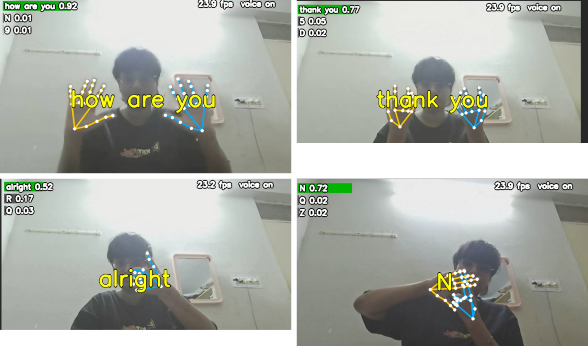

# SignSpeak - Real-time Indian Sign Language to speech

A stand-alone device that watches a signer through a camera, recognises Indian Sign Language
(ISL) signs and speaks them aloud. It runs entirely on a **Raspberry Pi 4** with a **Pi Camera
v1.3** and a small speaker - no PC, no network, no screen. Plug in the power bank and it says
"ready".

Camera -> MediaPipe hand landmarks -> time-based window (0.63 s) -> small temporal CNN -> speech.
45 signs out of the box: the alphabet A-Z, digits 0-9 and nine greetings (hello, how are you,
thank you, pleased, alright, good morning / afternoon / evening / night).



| | |
|---|---|
| Hardware | Raspberry Pi 4 Model B, Pi Camera v1.3 (OV5647), 4 ohm speaker on the 3.5 mm jack, 40 mm fan, 20 000 mAh power bank |
| Software | Raspberry Pi OS (64-bit), Python 3.12, MediaPipe 0.10.18, NumPy, espeak-ng |
| Speed on a Pi 4 | ~4.5-5.5 fps with both hands moving (laptop: 24-30 fps) |
| Full documentation | [`report/SignSpeak_Lifecycle_Report.pdf`](report/SignSpeak_Lifecycle_Report.pdf) |

## Repository
```
run.py              real-time recogniser (window or --headless), decision logic, speech
isl_core.py         camera (webcam / Pi camera), hand tracking, features, TimedWindow, classifier, speech
collect.py          record training clips (timed, resampled to 30 fps on any device)
train.py            train the classifier (PyTorch, CPU is enough) -> models/isl_classifier.npz
import_dataset.py   import public datasets (landmark CSV, photo sets, INCLUDE videos)
models/             shipped classifier + MediaPipe hand landmark model
deploy/             systemd service + installer for autostart on the Pi
report/             final lifecycle report (PDF)
```

## Raspberry Pi 4 (the product)
Raspberry Pi OS **64-bit**. MediaPipe 1.x needs ARM crypto instructions the Pi 4 lacks, so the
Pi uses MediaPipe 0.10.18 in a Python 3.12 environment (installed with `uv`):
```
sudo apt install -y espeak-ng
curl -LsSf https://astral.sh/uv/install.sh | sh      # then open a new terminal
cd ~/signlng_cam
uv python install 3.12
uv venv -p 3.12 .venv
uv pip install -p .venv -r requirements-pi.txt
.venv/bin/python run.py --source picam               # test with a window
sh deploy/install_autostart.sh                       # start automatically at every boot
```
The camera is read through `rpicam-vid`, so no Picamera2 is needed in the venv.
Useful service commands: `journalctl --user -u signlang -f` (live log),
`systemctl --user stop|start signlang`.
For safe unplugging, enable the read-only overlay file system in `sudo raspi-config`
(Performance Options) after setup.

## Laptop / PC (development)
```
python -m venv .venv
.venv\Scripts\activate
pip install -r requirements.txt
python run.py                 # webcam
python run.py --spell         # letters -> words, spoken at a pause
```
Keys: `q` quit, `c` clear, `v` voice on/off. Options: `--threshold` (default 0.5),
`--min-hold`, `--log` (top-3 guesses per frame), `--headless`.

## Training your own signs
```
python collect.py _none hello thank_you --clips 20   # SPACE starts each sign
python train.py
```
Always record `_none` (hands visible but not signing) - it stops false outputs between signs.
`download_script.sh` fetches the public INCLUDE dataset; `import_dataset.py` converts it.

## Team
Group 5, School of Electronics Engineering, KIIT University - Electronic Product Development (Sessional).
